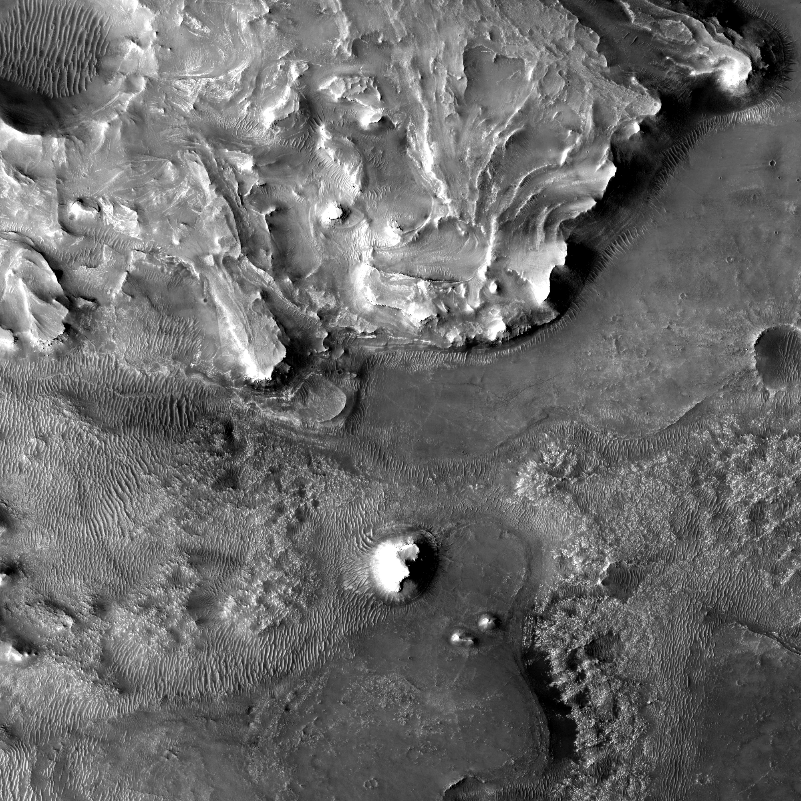
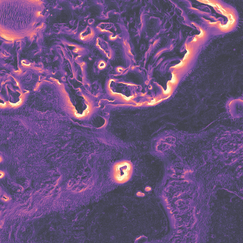
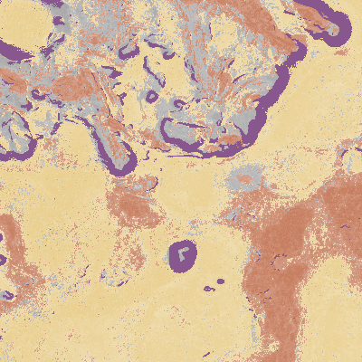
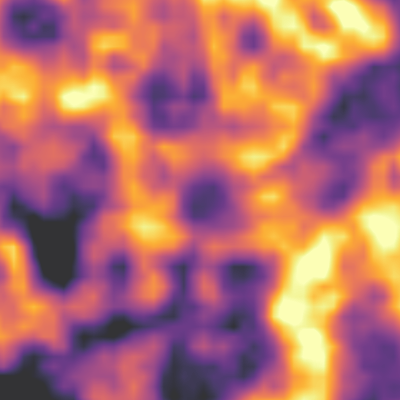

# Marswalk

**Plan safe walks on Mars from real NASA data, and know before you leave that you can get home.**

> 🏆 **Winner: Best Mission Application**, NASA Space Apps Challenge 2026, UTAS Ibra, Oman

Neon Genesis · NASA Space Apps Challenge 2026 · UTAS Ibra, Oman
Challenge: *Interplanetary Survival Guide: Martian Map*

| Optical (HiRISE 25 cm) | Slope (HiRISE 1 m DTM) | Terrain classes | Night thermal (THEMIS) |
|---|---|---|---|
|  |  |  |  |

## The problem

The first crew on Mars will step out onto ground nobody has walked on. Their suits carry a fixed supply of power and
oxygen. Steep slopes and soft sand slow them down, and Earth can't help in real time: a radio message takes up to
22 minutes each way. Every walk outside comes down to one question: **can we get there and still get home?**

## Our solution

Marswalk is a walk planner for a crewed base at **Three Forks, Jezero Crater** (18.4529° N, 77.4083° E), where
Perseverance left its first sample depot. A crew picks science stops, and Marswalk:

- maps the ground from four NASA datasets into a 10 m grid: slope, roughness, night-time thermal and material type;
- plans two routes: **time-focused** (fastest) and **conservative** (avoids the steepest patches and uncertain ground);
- checks at every point of the route that **time, energy and oxygen, each minus a reserve, still cover the walk home**;
- **says no when a stop is unsafe**, explains why, and offers the nearest safe place to view it from;
- lets the crew **rehearse** surprises: block a passage, replan, and see what changed.

## NASA data

All data comes from NASA missions, through NASA and USGS Astrogeology.

| Layer | Mission and product | Resolution | Used for |
|---|---|---|---|
| Elevation | MRO HiRISE DTM `JEZ_hirise_soc_006` | 1 m | Slope, roughness |
| Image | MRO HiRISE orthomosaic `JEZ_hirise_soc_006` | 25 cm | Base map, brightness, texture |
| Thermal | Mars Odyssey THEMIS Night IR Controlled Mosaic v2 | 100 m | Sand vs rock (stand-in for thermal inertia) |
| Ground truth | Mars 2020 Perseverance traverse (`M20_traverse.json`) | – | Validation |

Stops: **Cape Nukshak** and **Hawksbill Gap** (rover sampling sites, located from Perseverance's position records)
and **Kodiak butte** (photographed by the rover from a distance, located on the HiRISE map).

## How it works

1. **Grid.** The 4 × 4 km box around the base becomes 400 × 400 cells of 10 m. Each cell stores its average slope,
   the slope of its steepest 10%, roughness, thermal value and image brightness and texture. East–west distances are
   corrected for latitude (×0.9486 at 18.45° N).
2. **Ground type.** A random forest classifies material (sand, bedrock, rough). Steepness is never predicted: it is
   measured from elevation, because slope can't be judged from a photo.
3. **Walking cost.** Slope and ground type set walking speed from a 3.3 km/h base (Apollo). Ground over the slope
   limit (15° default, up to 20°) is blocked.
4. **Routes.** A cost-distance search finds the fastest path between base and every stop; every stop order is tried.
5. **Safety.** A stop counts as reached only if its own cell is walkable. At every route point the get-home rule
   checks time, energy (2.8 kWh) and oxygen (8.6 kg), with a reserve of 30 min + 20% of walking time (max 60 min)
   that is never spent. If a check fails, the plan is refused and the planner names the resource that ran short.

Full method: [`backend/README.md`](backend/README.md).

## Results

Default plan: 3.3 km/h, 15° limit, 6 h budget.

| Check | Result |
|---|---|
| Stop distances vs research brief | 409 / 373 / 769 m, exact |
| Rover track on ground we call walkable | **99.1%** (whole area: 93.7%) |
| Our route vs Perseverance's path, Three Forks ↔ Hawksbill Gap | **median 22 m** apart |
| HiRISE elevation vs rover's own elevation | median +0.01 m, 90% within ±0.5 m |
| Terrain classifier, tested on 1 km areas it never saw | **67%** (always guessing sand: 53%) |
| Most useful classifier input | THEMIS night thermal (importance 0.24) |
| Both routes | 2.9 km, 185 min, about 130 min spare; time is the limiting resource |
| Steepest section | 19.3° time-focused (flagged) vs 14.9° conservative |
| Unsafe stops at 15° | Hawksbill Gap (17.6°) and Kodiak butte (35.6°) viewed from 9 m and 99 m away |
| Rehearsal: 200 m blockage near Hawksbill Gap | +1.8 km and +45 min, still safe; a 400 m blockage drops the stop |
| Full rebuild from raw NASA files, network off | ~30 s, identical output |

## Run it

You need **Python 3.12, 3.13 or 3.14** and **Node.js 22.12+ or 24+**. Python 3.15 does not work yet: one library
(scikit-image) has no 3.15 release. On Windows, install
[Python 3.14](https://www.python.org/downloads/release/python-3140/) alongside any other version; the commands
below select it with `py -3.14`.
No data download is needed: the repository includes the processed 10 m terrain grid (`backend/data/demo/`, 5 MB).
Use two terminals, both starting in the repository folder.

**Windows (PowerShell or Command Prompt)**

```powershell
# Terminal 1: planner API
cd backend
py -3.14 -m venv venv
.\venv\Scripts\python -m pip install -r requirements.txt
.\venv\Scripts\python scripts\server.py
```

```powershell
# Terminal 2: app
cd frontend
npm ci
npm run dev:api
```

**macOS / Linux**

```sh
# Terminal 1: planner API
cd backend
python3.14 -m venv venv   # or python3.12 / python3.13
venv/bin/python -m pip install -r requirements.txt
venv/bin/python scripts/server.py
```

```sh
# Terminal 2: app
cd frontend
npm ci
npm run dev:api
```

Open **http://localhost:5173**. Terminal 1 should show `Planner API on http://127.0.0.1:8000`; keep both running.

If Windows says *"running scripts is disabled on this system"*, use `npm.cmd ci` and `npm.cmd run dev:api`
instead, or run the same commands in Command Prompt. If `py -3.14` says no such runtime is found, install Python 3.14
from the link above. If `pip install` fails, check `.\venv\Scripts\python --version` shows 3.12–3.14; if not, delete
the `venv` folder and create it again with `py -3.14`.

Without the backend, `npm run dev` with `VITE_DATA_MODE=mock` in `frontend/.env.local` shows the bundled example
data (route planning needs the backend).

**Rebuild from raw NASA data (optional, macOS/Linux, needs `make` and `curl`):** in `backend/`,
`make download` (once, ~3.3 GB) then `make all` (~30 s, offline). The server then uses the rebuilt
`data/processed/` instead of the bundled grid. See [`backend/README.md`](backend/README.md).

## Limits we know about

- **Walking and power figures come from Apollo,** a Moon stand-in. No Mars-suit walking data exists yet. Each figure
  is one constant in the code.
- **Speed slowdowns for slope and ground type are our own cautious assumptions.** They change timing, not safety;
  safety comes from the measured slope limit and the reserve.
- **The classifier is modest (67%).** It was trained on 128 labelled cells. It only affects walking speed.
- **Training labels were made with AI assistance** and checked blind by two team members: 25 of 37 cells agreed (68%).
- **THEMIS night IR is 100 m per pixel,** so it describes the area around a cell, not the cell itself.
- **Uphill and downhill cost the same.**
- **A rover is not an astronaut.** Perseverance's track is the best ground truth available, used to check the map,
  not to set the rules.

## Future work

- **Live suit telemetry** (heart rate, oxygen use) feeding the get-home rule, so a tired astronaut is told to turn
  back sooner. We chose not to model health from already-assumed suit data.
- Mars-suit walking and power data in place of Apollo's, as NASA tests them.
- More labels, checked by geologists, to improve the classifier.
- Direction-aware walking cost (uphill vs downhill), an elevation profile per route, and a conditions panel (light,
  dust, temperature).
- Other sites: the pipeline takes any box with HiRISE elevation coverage.

## Team

| Member | Role |
|---|---|
| Afan | Team lead; data pipeline, terrain classifier, routing and planner API; frontend–backend integration, frontend bug fixes and additional UI features |
| Alaa | Science research: site selection, mission parameters, sources, pitch deck |
| Omair | Frontend: React, TypeScript, Vite and Leaflet map interface |

## Use of AI

- **Labels:** the 160 training labels were made with AI assistance from HiRISE image patches, then checked blind by
  two team members (agreement reported above).

## Credits

HiRISE data: NASA/JPL-Caltech/University of Arizona. THEMIS data: NASA/JPL-Caltech/Arizona State University.
Mars 2020 traverse: NASA/JPL-Caltech. Data products distributed by USGS Astrogeology Science Center.
Apollo traverse and suit figures: NASA.
